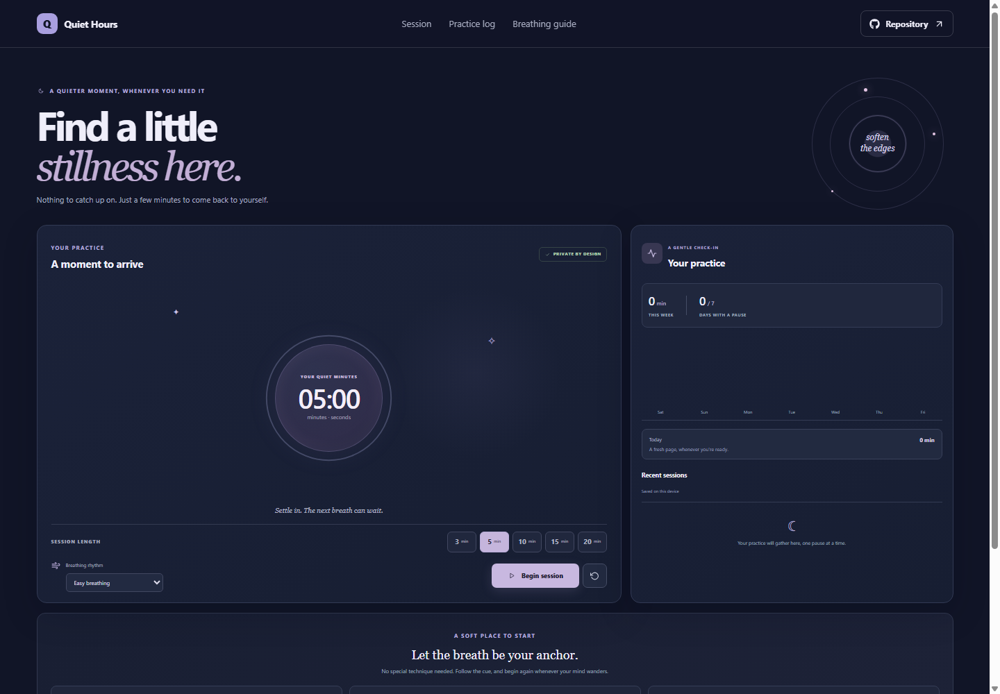

# Quiet Hours: Meditation Timer

Quiet Hours gives you a small, focused space for a timed breathing practice. Choose a few minutes, follow a gentle inhale and exhale cue, and return to your day when the timer ends.

**Project repository:** https://github.com/a2rp/meditation-timer
**Deployed site:** https://a2rp.github.io/meditation-timer/

## What you can do

- Choose a 3, 5, 10, 15, or 20 minute session.
- Start, pause, resume, reset, or restart a timer.
- Follow an easy breathing rhythm or a four-part box breathing rhythm.
- Review daily and weekly practice totals with a seven-day chart.
- Review, remove, or clear completed sessions with confirmation.

## How to use it

Choose a session length and breathing rhythm, then begin. The circle fills as time passes and the text offers the next breathing cue. Pause or reset whenever you like. Completed sessions appear in the practice log.

## Data and privacy

Completed sessions are saved in local storage in this browser. The app does not send session details to a server. Clearing browser site data removes the saved log. This timer is a general wellness tool and does not provide medical or mental health advice.

## Run and check locally

Install dependencies with `npm install`, then start the Vite development server with `npm run dev`. Run `npm run lint` for ESLint and `npm run build` for a production build. Run `npm run deploy` to publish the `dist` folder to the `gh-pages` branch.

## Future improvements

Ideas only. These are not implemented yet:

- Add optional background ambience with an explicit volume control.
- Add more breath patterns and a custom rhythm editor.
- Offer a printable practice summary.

## Links

- Portfolio: [https://www.ashishranjan.net](https://www.ashishranjan.net)
- GitHub: [https://github.com/a2rp](https://github.com/a2rp)
- CodePen: [https://codepen.io/ash1198](https://codepen.io/ash1198)
- LinkedIn: [https://www.linkedin.com/in/aashishranjan](https://www.linkedin.com/in/aashishranjan)
- Facebook: [https://www.facebook.com/theash.ashish/](https://www.facebook.com/theash.ashish/)
- YouTube: [https://www.youtube.com/@ashishranjan-ashz?sub_confirmation=1](https://www.youtube.com/@ashishranjan-ashz?sub_confirmation=1)
- Email: [mailto:ash.ranjan09@gmail.com](mailto:ash.ranjan09@gmail.com)

## Support

- Support: [https://a2rp-donation-page.netlify.app/](https://a2rp-donation-page.netlify.app/)
- Buy Me a Coffee: [https://buymeacoffee.com/ashishranjan](https://buymeacoffee.com/ashishranjan)
- Patreon: [https://www.patreon.com/ashishranjan](https://www.patreon.com/ashishranjan)